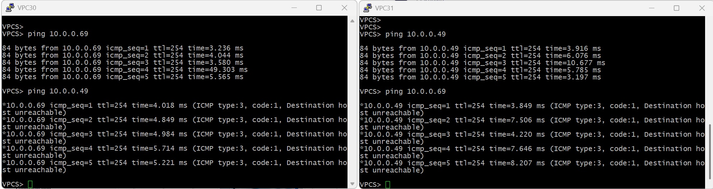

## Домашнее задание №1
#### Проектирование сети

<p align="center">
  
</p>

Цель:

Настроить политику маршрутизации в офисе Чокурдах и распределить трафик между двумя линками.

<!-- ================================================================================================================ -->
<!-- ================================================================================================================ -->

### Настройка R28
<p align="center">
  
  <br>
  <em>Топология и адресация сетей Чокурдах, Лабытнанги</em>
</p>

<!-- ================================================================================================================ -->
<!-- ================================================================================================================ -->

#### Политика маршрутизации

ISP для VPC30 будет R25 если он не доступен то R26

ISP для VPC31 будет R26 если он не доступен то R25

```cisco
configure terminal

ip access-list extended PBR_VPC30
 permit ip host 192.168.30.10 any
exit

ip access-list extended PBR_VPC31
 permit ip host 192.168.30.11 any
exit

ip sla 10
 icmp-echo 10.0.0.69 source-interface GigabitEthernet0/1
 frequency 5
exit

ip sla schedule 10 life forever start-time now

ip sla 20
 icmp-echo 10.0.0.49 source-interface GigabitEthernet0/0
 frequency 5
exit

ip sla schedule 20 life forever start-time now

track 10 ip sla 10 reachability
exit

track 20 ip sla 20 reachability
exit

route-map PBR_CHKD permit 10
 match ip address PBR_VPC30
 set ip next-hop verify-availability 10.0.0.69 10 track 10
 set ip next-hop verify-availability 10.0.0.49 20 track 20
exit

route-map PBR_CHKD permit 20
 match ip address PBR_VPC31
 set ip next-hop verify-availability 10.0.0.49 10 track 20
 set ip next-hop verify-availability 10.0.0.69 20 track 10
exit

interface GigabitEthernet0/2.30
 ip policy route-map PBR_CHKD
exit

end
```
Команды для проверки
```cisco
show ip sla statistics
show track
show route-map PBR_CHKD
show ip policy
```
Для показательной проверки добавил на R25 и R25 маршруты
```cisco
На R25: ip route 192.168.30.0 255.255.255.0 10.0.0.70
На R26: ip route 192.168.30.0 255.255.255.0 10.0.0.50
```
Получил такой результат
<p align="center">
  
  <br>
  <em></em>
</p>
