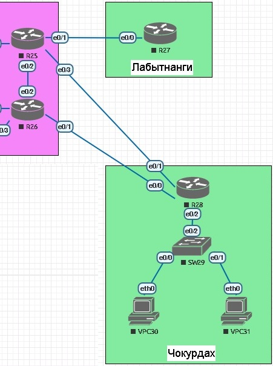
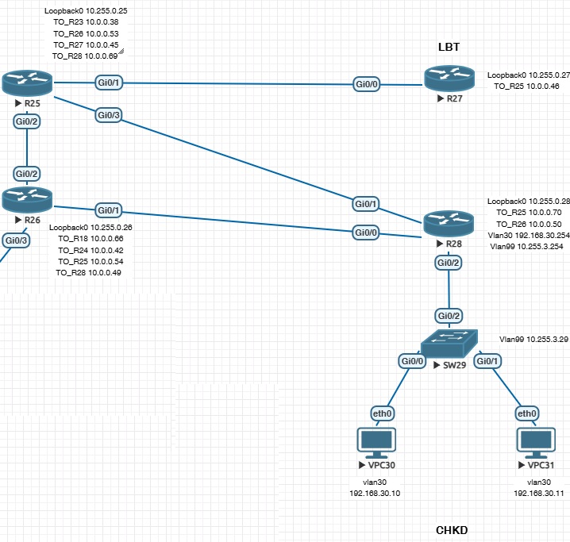

## Домашнее задание №1
#### Проектирование сети

Цель:
Настроить политику маршрутизации в офисе Чокурдах и распределить трафик между двумя линками.

<!-- ================================================================================================================ -->
<!-- ================================================================================================================ -->
### Настройка R28

